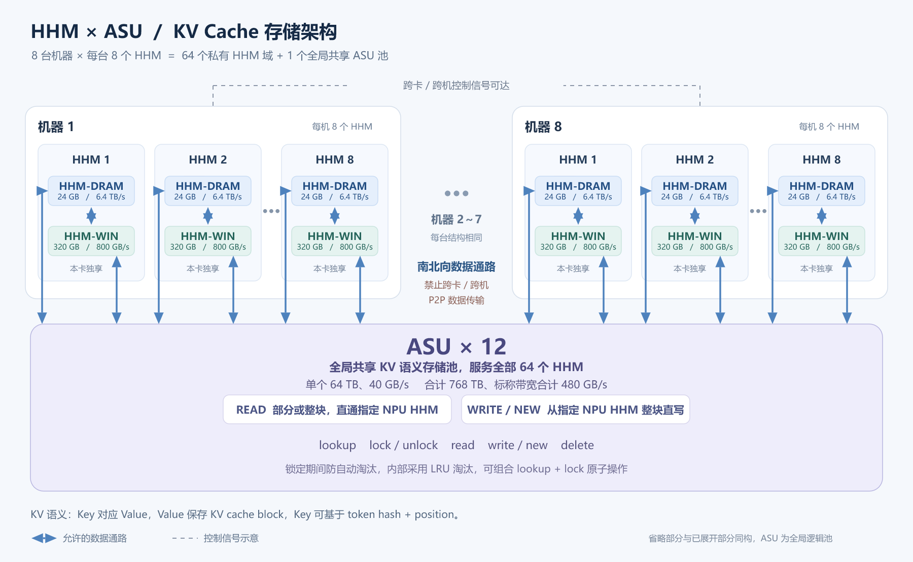
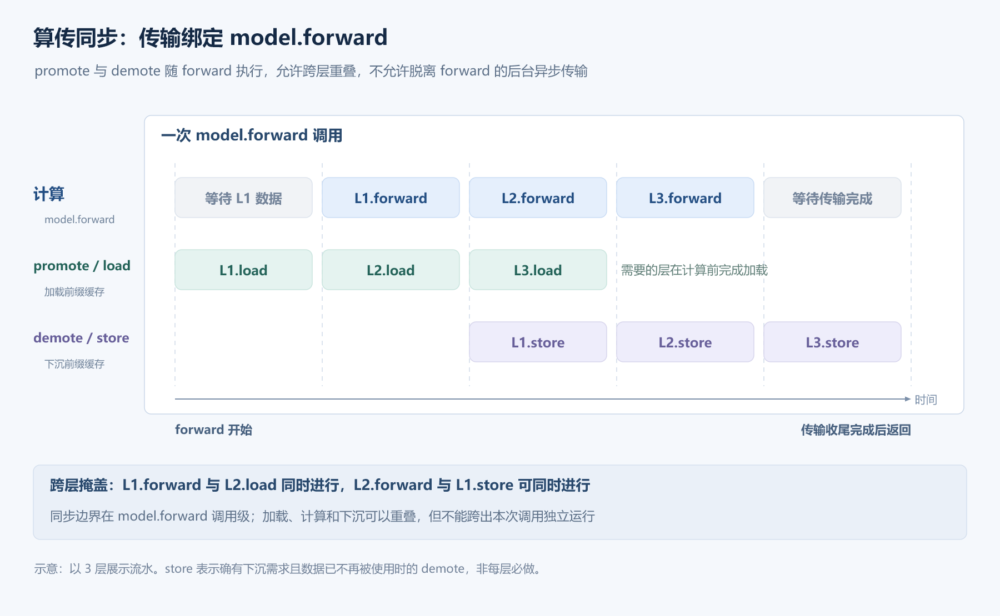
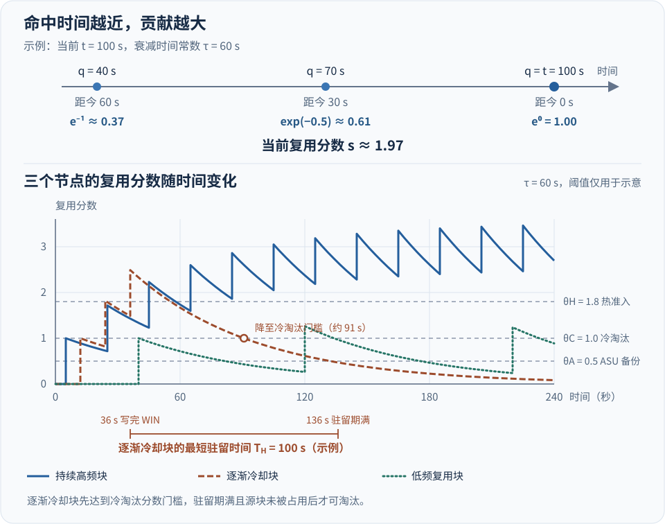
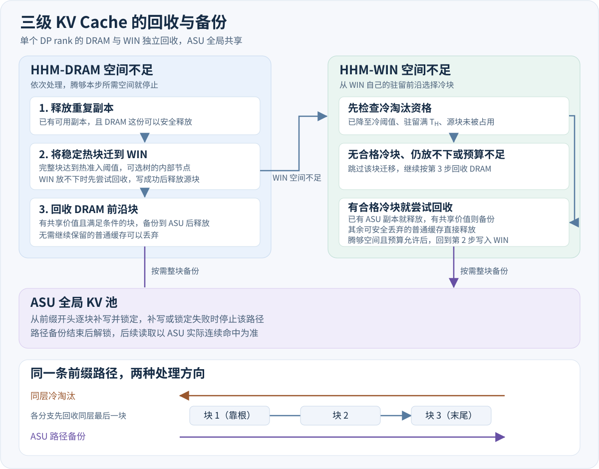

# HHM–ASU KV Cache 仿真设计

## 1. 目标与范围

在多节点推理集群中仿真前缀 KV Cache 的复用、数据搬运和请求调度，评估分层缓存对时延、命中率和写入量的影响。以一次 `model.forward` 为最细的计算事件，使用给定的计算时延，不模拟层内算子。层间算传重叠在仿真中用 forward 级的有效传输开销表示。

## 2. 硬件与互联

典型配置为 8 台机器，每台 8 张 NPU 卡。每张卡独享 HHM-DRAM 和 HHM-WIN，全部 64 张卡共享同一个 ASU 逻辑池。

| 层级 | 共享范围 | 容量 | 标称带宽 |
| --- | --- | ---: | ---: |
| HHM-DRAM | 单卡独享 | 24 GB/卡 | 6.4 TB/s/卡 |
| HHM-WIN | 单卡独享 | 320 GB/卡 | 800 GB/s/卡 |
| ASU | 全局共享，12 个设备 | 64 TB/设备，共 768 TB | 40 GB/s/设备，标称合计 480 GB/s |

ASU 合计带宽为设备标称值之和。数据面仅允许本卡 **HHM-DRAM ↔ HHM-WIN**、**HHM-DRAM ↔ ASU** 和 **HHM-WIN ↔ ASU**。卡间和机间允许传递控制信号，禁止通过东西向 P2P 通路搬运数据。

*图 1　HHM–ASU 存储架构。*

分层形态可类比 HiCache 的 HBM、DRAM、SSD。仿真按卡分配 WIN 容量，不建模卡间 WIN 复用。若对照方案也按卡管理中间层缓存，两者可采用相似的软件管理抽象。

## 3. ASU 对象与接口

ASU 建模为类似 NVIDIA ICMS 的高带宽、高 IOPS、全局池化 KV 语义存储。KV 语义定义按 Key 管理 Value 的接口，Value 保存推理产生的 KV Cache block。Key 可由**前缀 token 哈希和块的逻辑位置**组成。哈希覆盖当前块及其前文，逻辑位置可用块编号或起始 token 下标表示。部分读取的偏移量用于选择 Value 内的数据范围。

| 操作 | 仿真语义 |
| --- | --- |
| `lookup(key)` | 查询对象是否存在。 |
| `lock(key)` / `unlock(key)` | 使用前锁定，使用完毕后解锁。锁定期间对象不参与自动淘汰。 |
| `read(key, range, dst)` | 读取部分或完整 KV block，数据从 ASU 直通指定 NPU 的 HHM。 |
| `write/new(key, src)` | 从指定 NPU 的 HHM 向 ASU 直写完整 KV block。 |
| `delete(key)` | 主动删除对象并释放空间。 |

ASU 在容量不足时按 LRU 淘汰可淘汰的对象。基本操作可按需组合成原子操作。例如，`lookup+lock` 将命中查询与锁定合并，避免对象在两者之间被淘汰。

## 4. 执行与算传同步

每台机器运行独立的推理调度器，采用 Prefill/Decode 共部，并作为一个 EP 域。不同 EP 域的 `model.forward` 独立推进。同一 EP 域内的各 rank 共享一次 forward 的调度边界。

所有前缀缓存的数据面传输，包括 promote 和 demote，均由所属的 `model.forward` 发起并在该调用返回前完成。初版采用层间流水，可在 `L1.forward` 期间执行 `L2.load`，也可在 `L2.forward` 期间执行满足条件的 `L1.store`。仿真仅在 forward 层级计入未被计算掩盖的传输时间。

*图 2　跨层算传重叠与 forward 返回边界。*

对正在 prefill 或 decode 的请求，HHM-DRAM 命中直接使用，HHM-WIN 命中无需将整个前缀预搬至 DRAM，仿真假定执行期滚动加载的开销可掩盖。HHM 未命中而 ASU 命中时，先将所需数据加载到本卡 HHM-DRAM，再执行依赖该数据的计算。两级均未命中时计算缺失的前缀。

## 5. KVC 管理算法

### 5.1 分层职责与状态

HHM-DRAM 负责观察复用情况和分流，HHM-WIN 保留稳定热块，ASU 按自身的全局 LRU 提供共享缓存。每个 DP rank 维护自己的 RadixTree，记录前缀关系、各层驻留状态、命中分数和 WIN 写入完成时间。节点对应可独立管理的 KV block。释放某层副本时清除该层的驻留记录，树节点可继续保留，以便查找其他层的副本和维护前缀关系。

### 5.2 复用分数与阈值

同一请求对同一节点最多计一次命中。节点在时刻 $t$ 的复用分数为

$$
s(v,t)=\sum_{q\in Q_v} e^{-(t-q)/\tau}
$$

其中 $Q_v$ 为节点 $v$ 的历史命中时刻集合，$\tau>0$ 为衰减时间常数。仿真实现只需保存上次更新的分数和时间。评估时先衰减到当前时刻，遇到该请求的首次命中再加 1。

| 参数 | 用途 |
| --- | --- |
| $\theta_H$ | WIN 热准入阈值，$s\ge\theta_H$ 的完整块可写入 WIN。 |
| $\theta_C$ | WIN 冷淘汰阈值，$s\le\theta_C$ 的块可进入冷淘汰候选。 |
| $\theta_A$ | 普通 ASU 备份阈值，$s\ge\theta_A$ 时可考虑共享备份。 |
| $T_H$ | WIN 最短驻留时间，从 WIN 写入完成时开始计时。 |

阈值满足 $\theta_A\le\theta_C<\theta_H$。热准入和冷淘汰之间的分数间隔，加上最短驻留时间，用来降低重复写入。已有明确的跨 rank 或跨机消费者时，可以跳过普通 ASU 备份的分数门槛，仍需满足容量、整块写入和传输预算约束。

*图 3　上图展示三次命中的分数计算，下图对比三种复用曲线。逐渐冷却块先达到冷淘汰分数门槛，再满足 WIN 最短驻留时间 $T_H$。图中参数仅用于示意。*

### 5.3 三级缓存回收与备份

*图 4　三级缓存回收与备份流程。图下方用三个块示意本地冷淘汰与 ASU 路径备份的顺序。*

#### 本地冷淘汰从前缀末尾往回

DRAM 和 WIN 分别判断哪些块可以优先回收。从一个还在该层的块出发，沿前缀顺序往后检查每条分支。如果后续都找不到还在同一层的块，它就是该层的**驻留前沿**，可以作为第一批冷淘汰候选。

例如，前缀顺序是「块 1 → 块 2 → 块 3」，块 1 和块 3 在 DRAM，块 2 只在 WIN。DRAM 先考虑块 3，因为它是这条分支上最后一个还在 DRAM 的块。块 3 的 DRAM 副本释放后，块 1 才进入 DRAM 前沿。回收前还要确认候选块未被活跃请求或传输占用。

#### DRAM 先释放重复副本，再按热度分流

DRAM 空间不足时，依次处理以下候选，释放空间达到本步需求后停止。

1. **释放重复副本。** 优先释放无需写下级即可安全删除的本地副本。例如，某个块在 ASU 已有可用副本，当前也不需要继续留在 DRAM，就直接释放 DRAM 里的这份。释放前先查询 ASU，确认对应的 Key 仍存在。若 ASU 后续淘汰了这个普通缓存块，下次需要时按未命中处理并重新计算。
2. **将稳定热块迁移到 WIN。** 从满足热准入条件的完整块中选取候选，可扫描整棵树，包括内部节点。先检查 WIN 剩余空间，放不下就尝试按下述「 WIN 回收规则」腾出空间。回收后空间足够，且相关传输能在本次 `model.forward` 的预算内完成，就写入 WIN。写成功且源副本不再被使用后，释放 DRAM。若仍放不下或预算不足，则跳过该块的迁移，继续按下一步回收 DRAM。
3. **从 DRAM 前沿回收其余可淘汰块。** 对有全局复用价值且满足备份条件的块，按下述「从前缀开头往后的 ASU 备份」的原则，沿路径逐块确认、补写并锁定，备份成功后再释放 DRAM 副本。未达到备份门槛或普通备份失败时，可丢弃无需保留的缓存块，由后续请求重算。

#### WIN 只回收已冷却的前沿块

从 WIN 自己的驻留前沿挑选满足三项条件的块：分数已降至冷淘汰阈值、驻留已满 $T_H$、源副本未被占用。有可用 ASU 副本时直接释放。达到 ASU 备份门槛且预算允许时，写入 ASU 后释放。其余普通缓存块可丢弃并在后续重算。

WIN 块重新变热时继续从 WIN 滚动读取并更新分数。需要为新迁移腾空间时，找不到合格冷块、回收后空间仍不足，或相关传输超出本步预算，均跳过该次 DRAM→WIN 迁移。

#### ASU 备份从前缀开头往后

沿前缀路径从第一个实际 KV 块开始，逐块执行 `lookup+lock`。如果块不在 ASU，就从本卡可用的完整副本写入，再确认并锁定成功。前面的块全部锁住后，才处理下一个块。已取得的锁一直持有到本次路径备份确认完成，期间 ASU 不自动淘汰这些块，主动删除也延后到解锁后处理。

任一块无法补写或锁定时，停止该路径的后续备份，释放本次已取得的锁，并将目标块按备份失败处理。备份成功后统一解锁。此后 ASU 可独立按 LRU 淘汰，后续查询以实际连续命中的前缀为准。

### 5.4 同步执行与释放条件

迁移、备份和相应释放纳入本次 `model.forward` 的同步执行预算。跨层重叠沿用第 4 节的流水模型。对于依赖目标副本的回收，先确认写入成功，再等源副本的使用者和传输结束，最后释放源块。若本步预算不足，可跳过普通备份，保留源块或按淘汰规则丢弃可重算的副本。需要保留给活跃请求或已承诺消费者的块，在依赖解除前继续保留。若仍无法腾出本步必需的空间，则缩小入批规模或延后相关请求。

## 6. 请求调度

**集群调度。** 全局调度器将请求分给预计 TTFT 最短的 DP rank。评分由机器当前 forward 的剩余时间、rank 的预计准入等待、剩余 Prefill 计算时间及未被掩盖的 ASU 加载时间组成。准入等待取待算 Prefill 积压与等待运行名额或 DRAM 空间的较大值。本卡 DRAM／WIN 命中和可从 ASU 恢复的连续前缀均减少待算 token，ASU 锁定和读取在准入时执行。评分相同时优先选距离上次分配最久的 rank。

**单机调度。** 上一次 forward 结束后立即决策下一次。有可入批的 prefill 时优先安排，并可与已有的 decode 请求组成混合 step。没有可入批的 prefill 时执行纯 decode step。请求入批还须满足所在卡的 HHM KV block 容量约束，运行中的 KV 占用计入该卡的 DRAM 或 WIN。

**批次上限。** 每个 DP rank 的 prefill 和 decode 共用两项预算。运行序列合计最多 64 条，对应 vLLM 的 `max_num_seqs=64`。每步调度的 token 合计最多 32,768 个，对应 `max_num_batched_tokens=32768`。Prefill 按本步需要计算的 token 计数，decode 按本步安排处理的 token 计数。

**并行方式。** Prefill 和 decode 均采用 DP8EP8。每台机器的 8 个 DP rank 各自组批，按本 rank 的序列数、token 预算和本卡 KV 容量调度。请求在同一 rank 完成 prefill 和后续 decode，KV 归该卡管理。8 个 rank 在同一个 EP 域内协同执行专家层。

## 7. 计算与时延模型

仿真目标模型为 **GLM-5.2-W8A8C8**，按 50 kB/token 估算 KV 占用。DP8EP8 下，每卡 HHM-WIN 的权重等占用按约 109 GB 预留，可用于 KV Cache 的空间约为 211 GB。

| Step 类型 | 计算时延抽象 |
| --- | --- |
| 纯 prefill、prefill 与 decode 混合 | 按 rank 使用 `num_batched_tokens / prefill_tps_effective`。初版暂取每 rank 2,000 TPS 作为可配置参考值，待实测校准。 |
| 纯 decode | 按每卡活跃请求数查下表。MTP5 下每个请求每步产出 1–6 个 token，可配置产出分布，目标均值约 4。 |

| 每卡 decode batch size | Step 时延（ms） | 数据性质 |
| ---: | ---: | --- |
| 1 | 40.6 | 原稿给定 |
| 4 | 44.5 | 原稿给定 |
| 8 | 53.2 | 原稿给定 |
| 12 | 59.1 | 原稿给定 |
| 16 | 66.7 | 原稿给定 |
| 20 | 73.1 | 原稿给定 |
| 24 | 83.2 | 原稿给定 |
| 28 | 88.6 | 原稿给定 |
| 32 | 97.9 | 原稿给定 |
| 64 | 172.3 | 暂按末段外推 |

沿用 28–32 段的斜率（2.325 ms/请求），得到 batch size 64 的时延 `97.9 + (64 − 32) × 2.325 = 172.3 ms`。对 1–64 之间的其他缺失整数点，在相邻表格点之间做分段线性插值，例如 batch size 2、3 分别为 41.9、43.2 ms。32 以上的时延待实测校准。这里的 step 时延以一次 forward 计，MTP 下每步可以产出多个 token，因此与请求级 TPOT 分开统计。

## 8. 评估指标

- **缓存命中率**。分别统计 HHM 命中率和 HHM 未命中后查询 ASU 的条件命中率。HHM 汇总口径对 WIN 和 DRAM 命中同等计分。另以「除新输入 token 外，其余 token 均可复用」为假设，计算理论最高命中率作为基线。基线与实际命中率采用同一统计单位比较。
- **写入量**。分别累计 HHM-WIN 和 ASU 的写入字节数。两层均有写寿命约束，优先关注 HHM-WIN 的写入开销。
- **Decode 批量**。统计每卡平均 batch size 及其时间序列。
- **请求时延**。统计 TTFT（首 token 时延）、TPOT（每输出 token 时间）和 TE2E（端到端时延）的均值及 P90。
